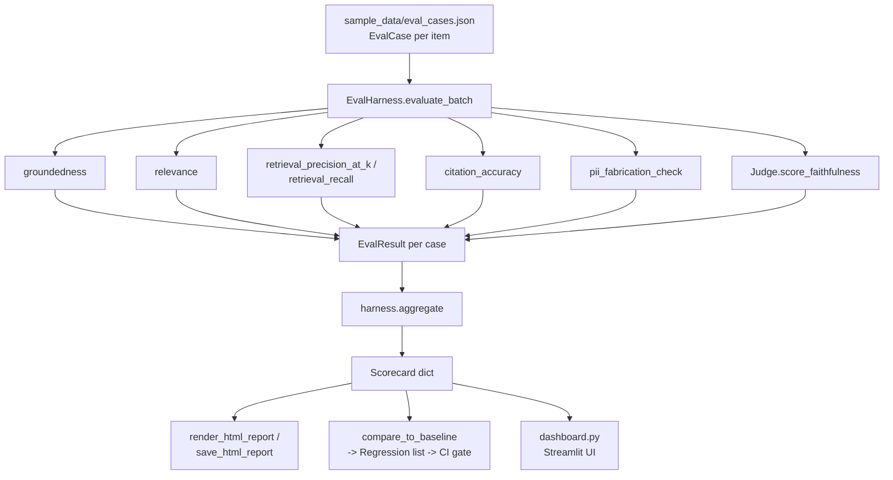

# RAGuard Architecture

RAGuard is a reference-free evaluation harness for RAG/LLM pipelines, built
to run offline by default and to gate CI on regressions, not just report a
score. This document explains the design decisions behind it.

## Data flow

Six metrics run per case (groundedness, relevance, retrieval precision,
retrieval recall, citation accuracy, PII fabrication), plus the pluggable
`Judge`'s faithfulness score, and every case produces one `EvalResult`.
Those roll up into a single `aggregate()` dict -- the scorecard -- which
feeds three consumers: an HTML report, the regression gate, and the
Streamlit dashboard.

## Why reference-free metrics

Most RAG eval setups ask for a hand-written "gold" answer per question so
they can compute something like BLEU/ROUGE/exact-match against it. That
doesn't scale: every new question needs a human to write and maintain a
correct answer, and production traffic has no gold answers at all.

RAGuard's metrics only use data the pipeline already produces at inference
time:

- `groundedness(answer, contexts)` and `relevance(answer, question)` are
  TF-IDF cosine similarities -- no gold answer required, just the question,
  the answer, and whatever got retrieved.
- `retrieval_precision_at_k` / `retrieval_recall` *do* need gold-labeled
  `relevant_ids`, but that's a much cheaper one-time labeling cost (which
  chunks are relevant to a question) than writing full gold answers, and it
  can be reused across many candidate answers and model versions.
- `citation_accuracy` and `pii_fabrication_check` need no labels at all --
  they check an answer's own claims (cited ids, PII strings) against what
  was actually retrieved.

This is what makes RAGuard usable directly against live or replayed
production traffic, not just a small curated golden set.

## Why citation_accuracy and pii_fabrication_check are distinct from groundedness

`groundedness` is a *lexical overlap* signal: it asks "does the answer's
wording look like it came from the retrieved text?" That is a good general
hallucination proxy, but it has blind spots:

- An answer can be comfortably grounded (reuses a lot of context
  vocabulary) while citing a source id the retriever never returned --
  a **phantom citation**. Cosine similarity over text has no visibility
  into id-level bookkeeping, so `citation_accuracy` checks the ids
  directly. `sample_data/eval_cases.json`'s `case-7-phantom-citation` is
  built exactly to demonstrate this: groundedness ~0.6-0.9, but
  `citation_accuracy == 0`.
- An answer can be well-grounded overall while still inventing a single
  fabricated detail -- a phone number, an email -- that was never in the
  retrieved context. A one-line fabrication barely moves a whole-answer
  cosine similarity score, but it's a real, specific harm.
  `pii_fabrication_check` catches this by diffing PII found in the answer
  against PII found in the contexts, independent of overall lexical
  overlap. `case-5-pii-fabricated` vs. `case-6-pii-sourced` in the sample
  data are the same *kind* of PII string, one invented and one genuinely
  sourced -- proving the check discriminates between them rather than
  just flagging "PII present."

In short: groundedness asks "does this sound supported overall", while
citation_accuracy and pii_fabrication_check ask "is this *specific claim*
actually backed by something retrieved." A pipeline can pass one check and
fail the other.

## Judge pluggability: HeuristicJudge vs. OpenAIJudge

`Judge` is a small ABC with one method, `score_faithfulness(answer,
contexts) -> (score, rationale)`. Two implementations exist:

- `HeuristicJudge` (default): a deterministic, free, fully-offline mapping
  of `groundedness` onto a 1-5 scale. It requires no API key and no network
  call, so `pytest`, the CLI, and the CI gate all run with zero external
  dependencies and zero cost.
- `OpenAIJudge` (opt-in): makes a real chat-completion call asking a model
  to rate faithfulness 1-5 with a one-sentence rationale. It's selected via
  `RAGUARD_JUDGE=openai` and is never required -- `get_default_judge()`
  only returns it when that env var is explicitly set, and nothing in the
  test suite or CI depends on it being available.

Swapping judges doesn't touch `EvalHarness`, `metrics.py`, or `cli.py` --
`EvalHarness(judge=...)` just takes any `Judge` implementation, so a team
could add a third backend (a local model, a different provider) without
changing anything else in the pipeline.

## Why regression gating is the actual point

A single `raguard run` gives you a snapshot: "this version scored
avg_groundedness=0.47." On its own, that number is close to meaningless --
is 0.47 good? Did a prompt change make it better or worse? You can't tell
from one run.

The actual value of RAGuard as a *harness* (as opposed to a scoring
library) is `raguard check`: it runs the eval, compares the resulting
scorecard to a saved `baseline.json`, and exits 1 if any metric moved the
wrong direction by more than a tolerance. That's what lets a pull request
that changes a prompt, a retriever, or a model get blocked automatically
when it quietly makes hallucinations or PII fabrication worse, instead of
that regression getting noticed days later in production.

### Direction-aware comparison

Not every metric improves by going up. `hallucination_flag_rate` and
`pii_fabrication_rate` are *bad-outcome rates* -- lower is better -- while
everything else (groundedness, relevance, precision, recall, citation
accuracy, faithfulness) is higher-is-better. `compare_to_baseline` keeps an
explicit `_LOWER_IS_BETTER` set and checks each metric against the
direction that actually matters for it:

- A naive "flag anything with current < baseline" check would wrongly
  flag a *drop* in `hallucination_flag_rate` (an improvement) as a
  regression.
- A naive "flag anything with a positive raw delta" check would wrongly
  *miss* a rise in `pii_fabrication_rate` (a real regression) because its
  delta is positive, not negative.

`tests/test_regression.py` tests both directions explicitly, plus the
tolerance boundary (exactly at `DEFAULT_TOLERANCE` is not a regression;
just past it is), because this is exactly the kind of off-by-one-and-wrong-
sign bug that would quietly defeat the whole CI gate.

### HTML reports as CI artifacts

`raguard run --html` and the CI workflow's "Upload HTML report artifact"
step exist so a human reviewing a failed or passing gate doesn't have to
re-run anything locally -- the self-contained HTML scorecard-plus-table is
attached directly to the GitHub Actions run.

## Non-goals (honest limitations)

- **TF-IDF, not embeddings.** `groundedness` and `relevance` use sparse
  lexical cosine similarity, not a semantic embedding model. This is fast,
  dependency-light, and fully offline, but it will miss paraphrases that
  use different words for the same idea, and it can be fooled by an answer
  that repeats context vocabulary without actually agreeing with it
  semantically. A production-grade version would likely add an embedding-
  based groundedness metric alongside (not instead of) the lexical one.
- **Regex PII detection, not a dedicated detector.** `find_pii` matches
  emails, phone numbers, and SSN-/credit-card-shaped strings with regular
  expressions. It will miss PII that doesn't match those shapes (names,
  addresses, less common ID formats) and can false-positive on structured
  numbers that happen to match a pattern. A real PII-fabrication pipeline
  would plug in a dedicated NER/PII model behind the same
  `pii_fabrication_check` interface.
- **One tolerance for every metric.** `DEFAULT_TOLERANCE = 0.05` applies
  uniformly across groundedness, citation accuracy, hallucination rate,
  etc. In practice, different metrics have different natural variance and
  different costs of a false alarm vs. a missed regression -- a more
  mature version would let `compare_to_baseline` take a per-metric
  tolerance dict instead of one global constant.
